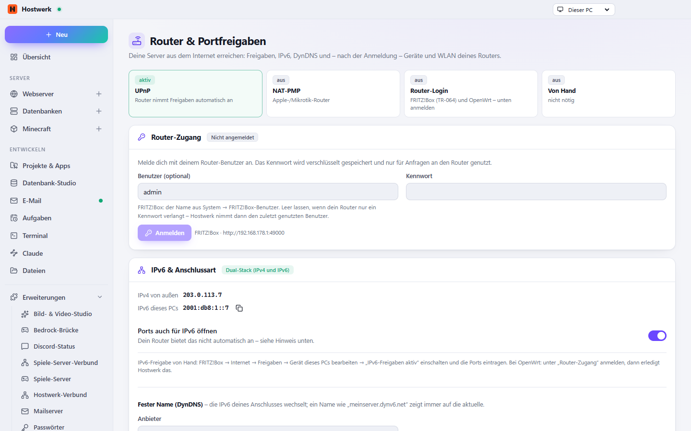

# Router & Portfreigaben

Macht deine Server aus dem Internet erreichbar: Portfreigaben über UPnP/NAT-PMP oder direkt über FRITZ!Box (TR-064) und OpenWrt, IPv6 und DS-Lite, DynDNS.

[English](README.md) · Offizielle [Hostwerk](https://github.com/Passimoritz/hostwerk-public)-Erweiterung (SDK 2.7, native Erweiterung)



## Was sie kann

- **Wo:** Livebetrieb → Erreichbar machen → Router und Übersichtskachel – seit 1.3.1 ohne eigenen Seitenleisten-Eintrag; die ganze Seite bleibt unter Erweiterungen → Öffnen
- Findet den Router selbst, gibt Ports mit einem Klick frei (UPnP/NAT-PMP)
- FRITZ!Box (TR-064) und OpenWrt direkt – Geräte, WLAN, neue IP-Adresse und Neustart
- MikroTik (RouterOS 7) und UniFi (UniFi OS) direkt – Freigaben und Geräte, bei UniFi auch WLAN
- Jede Freigabe zeigt ihre Herkunft (Hostwerk, welche Erweiterung, von Hand, anderes Gerät) und lässt sich „von außen“ prüfen (öffentliche Port-Prüfung ifconfig.co, nur auf Klick)
- Gast-WLAN mit QR-Code zum Beitreten – zum Ausdrucken und an den Kühlschrank
- IPv6 und DS-Lite, DynDNS – unter „Anschluss-Details …“, zusammen mit Router-Adresse, diesem PC und öffentlicher Adresse
- „Für Freunde im Internet“ an jedem Minecraft-Server
- Freigaben anderer Erweiterungen (Dateifreigabe, Bedrock-Brücke …) mit Besitzer – die Automatik behält sie
- **Kein eigener Eintrag in der Seitenleiste mehr (ab 1.3):** der Router steht im Livebetrieb unter *Erreichbar machen →
  Router*, dazu eine Kachel für die Übersicht (Übersicht → Anpassen). Die volle Seite bleibt über *Erweiterungen → Öffnen*
  erreichbar.
- **Überblick oben:** Router erkannt (mit UPnP-Zustand: an, aus, nur teilweise erlaubt, NAT-PMP), Freigaben, „von außen
  erreichbar?“ für alle freigegebenen TCP-Ports auf einmal, öffentliche IPv4 und IPv6
- **Konflikte:** Port geht an ein anderes Gerät, Port wird doppelt gebraucht (Erweiterung und Dienst), Hostwerk-Freigabe
  wird nicht mehr gebraucht – je mit einem Satz, was zu tun ist
- **Carrier-NAT, DS-Lite, doppeltes NAT** werden erkannt und ehrlich erklärt – wo Freigaben nichts bringen, bietet die
  Seite Tunnel („Seite teilen“) und VPN ohne Freigabe (Tailscale & Co. über die Erweiterung „VPN-Zugang“) an
- Fehlermeldungen als Sätze statt Codes (Zeitüberschreitung, Router aus, NAT-PMP abgelehnt, interner Router-Fehler …)
- Spalte „Angelegt von“: wer jede Freigabe angelegt hat (Besitzer aus `router.forwards`)

## Installieren

In Hostwerk unter **Erweiterungen → Entdecken** auf „Installieren“ klicken. Wer die Funktion schon in Hostwerk 2.8 benutzt hat, bekommt die Erweiterung beim Update automatisch – mit allen Daten.

Native Erweiterungen laufen als Teil von Hostwerk (eigener Server- und Oberflächen-Teil). Darum installiert Hostwerk sie nur aus dem offiziellen Katalog (mit Prüfsumme) oder im Entwickler-Modus.

## Daten

`settings.router` – genau dort, wo Hostwerk sie schon immer abgelegt hat. Entfernen der Erweiterung löscht nichts.

## Entwickeln

```bash
node --test tests/*.test.js          # Tests
node build-native.js .               # Oberfläche bauen (sdk/build-native.js aus hostwerk-public)
node check.js . --strict             # Prüfung wie im Katalog (sdk/check.js)
```

Die Treiber für MikroTik und UniFi laufen in `tests/overview.test.js` auch gegen Hostwerks Nachbildungen echter Router (`scripts/lib/sim`: RouterOS-7-REST, UniFi OS mit CSRF-Token und Sitzungs-Erneuerung, selbstsigniertes Zertifikat, fehlende Rechte, Zwei-Faktor) – das Haupt-Repo wird neben diesem Ordner oder über `HOSTWERK_DIR` gefunden, sonst werden diese Tests übersprungen. FRITZ!Box (TR-064) und OpenWrt prüfen `tests/access.test.js` gegen eigene Attrappen.

Quelltext der Oberfläche in `ui/src`, Server-Teil in `server/`. Texte im Code sind Englisch, Deutsch steht in `locales/de.json`.

Für andere Erweiterungen (`host.use('router')` oder `ctx.router`, vorher `typeof router.forwards === 'object'` prüfen – ab 1.2):

```js
await router.forwards.add({ port: 2022, protocol: 'TCP', label: 'SFTP' }, host.id);   // gibt gleich frei und merkt es sich
await router.forwards.remove({ port: 2022, protocol: 'TCP' }, host.id);               // nur eigene Einträge
router.forwards.list();                                                                // [{ port, protocol, label, owner }]
```

## Lizenz

MIT
