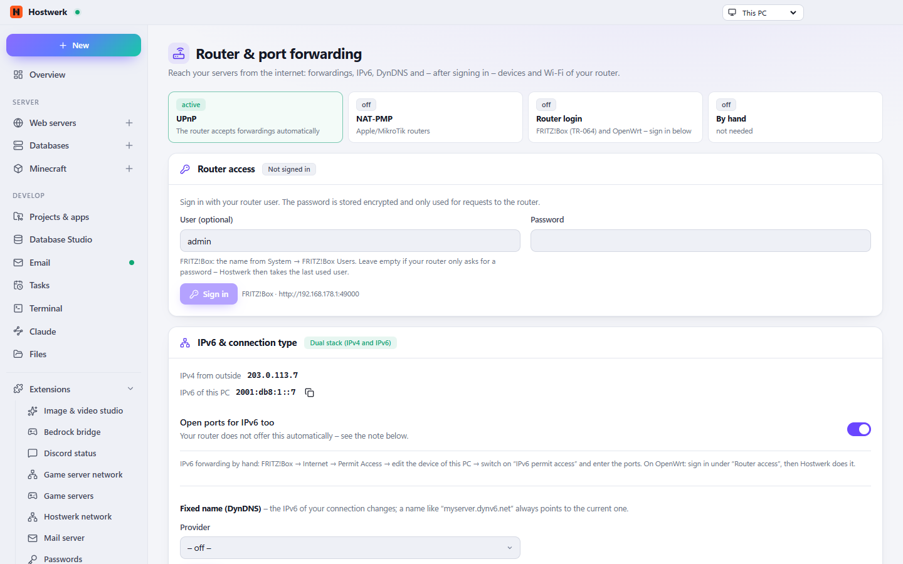

# Router & port forwarding

Makes your servers reachable from the internet: port forwarding via UPnP/NAT-PMP or directly through FRITZ!Box (TR-064) and OpenWrt, IPv6 and DS-Lite, DynDNS.

[Deutsch](README.de.md) · An official [Hostwerk](https://github.com/Passimoritz/hostwerk-public) extension (SDK 2.7, native extension)



## What it does

- Finds the router by itself, forwards ports with one click (UPnP/NAT-PMP)
- FRITZ!Box (TR-064) and OpenWrt directly – devices, Wi-Fi, new IP address and reboot
- MikroTik (RouterOS 7) and UniFi (UniFi OS) directly – forwardings and devices, on UniFi also Wi-Fi
- Every forwarding shows where it comes from (Hostwerk, which extension, by hand, another device) and can be checked “from outside” (public port check ifconfig.co, only on click)
- Guest Wi-Fi with a QR code to join – print it and put it on the fridge
- IPv6 and DS-Lite, DynDNS
- “For friends on the internet” on every Minecraft server
- Forwardings of other extensions (file share, Bedrock bridge …) with their owner – the automatic mode keeps them
- **No own sidebar entry any more (since 1.3):** the router lives in Go live under *Make reachable → Router*, plus a tile
  for the dashboard (Dashboard → Customise). The full page stays reachable from *Extensions → Open*.
- **At a glance:** router found (with UPnP state: on, off, only partly allowed, NAT-PMP), forwardings, “reachable from
  outside?” for every forwarded TCP port at once, public IPv4 and IPv6
- **Conflicts:** port goes to another device, port wanted twice (extension and service), Hostwerk forwarding no longer
  needed – each with a sentence on what to do
- **Carrier NAT, DS-Lite, double NAT** are recognised and explained honestly – where forwardings cannot help, the page
  offers the tunnel (“Share a page”) and a VPN without forwarding (Tailscale & co. through the “VPN access” extension)
- Errors as sentences instead of codes (timeout, router off, NAT-PMP refused, internal router error …)
- Column “Set up by”: who created each forwarding (owner from `router.forwards`)

## Install

In Hostwerk: **Extensions → Discover** and click “Install”. If you already used this feature in Hostwerk 2.8, the update installs the extension by itself – with all your data.

Native extensions run as part of Hostwerk (own server and interface part). That is why Hostwerk only installs them from the official catalogue (with checksum) or in developer mode.

## Data

`settings.router` – exactly where Hostwerk always kept it. Removing the extension deletes nothing.

## Develop

```bash
node --test tests/*.test.js          # tests
node build-native.js .               # build the interface (sdk/build-native.js from hostwerk-public)
node check.js . --strict             # same check as the catalogue (sdk/check.js)
```

The drivers for MikroTik and UniFi also run in `tests/overview.test.js` against Hostwerk's replicas of real routers (`scripts/lib/sim`: RouterOS 7 REST, UniFi OS with CSRF token and session renewal, self-signed certificate, missing rights, two-factor) – the main repository is found next to this folder or through `HOSTWERK_DIR`, otherwise these tests are skipped. FRITZ!Box (TR-064) and OpenWrt are tested in `tests/access.test.js` against their own fakes.

Interface source in `ui/src`, server part in `server/`. Texts in the code are English, German is in `locales/de.json`.

For other extensions (`host.use('router')` or `ctx.router`, check with `typeof router.forwards === 'object'` – since 1.2):

```js
await router.forwards.add({ port: 2022, protocol: 'TCP', label: 'SFTP' }, host.id);   // forwards now and remembers it
await router.forwards.remove({ port: 2022, protocol: 'TCP' }, host.id);               // only own entries
router.forwards.list();                                                                // [{ port, protocol, label, owner }]
```

## License

MIT
